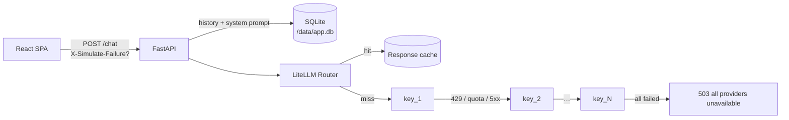

# Chatter

A multi-turn LLM chat that keeps working when an API key fails. Every request goes through a
[LiteLLM](https://github.com/BerriAI/litellm) key pool with automatic failover and a response
cache, and every reply tells you exactly how it was served: from cache or live, which model and
key answered, how long it took and how many tokens that request used.

**Stack:** React + TypeScript (Vite, Tailwind) · FastAPI · LiteLLM · SQLite · Docker



## Features

**Chat**
- A clean web UI for multi-turn conversations, with a new session on every page load.
- An optional per-session system prompt.
- Errors (422 validation, 503 all providers down, network) show as readable messages in the
  chat, never a blank screen.

**Per-reply metadata**, shown next to every assistant message:
- resolution source: `LIVE_INFERENCE` or `LLM_CACHE`
- the model that answered
- latency in milliseconds
- input and output tokens *for that request only*, never a running total
- which key answered and how many keys failed first

**Resilience**
- A key pool of two or more API keys behind LiteLLM. When a key returns HTTP 429, a quota error
  or a 5xx, the request automatically fails over to the next key.
- A clean `503 {"detail": "all providers unavailable"}` when every key fails. The failed turn is
  never saved to history.
- An `X-Simulate-Failure` request header (for example `key_1=429`, `key_1=429,key_2=500`,
  `*=429`) makes chosen keys fail for one request, so failover can be shown on demand. It's
  enabled with `ENABLE_FAILURE_SIMULATION=true`.

**Caching**
- LiteLLM's built-in response cache, keyed on model + the full message list (system prompt +
  history + new message). Asking the same first question in a new session returns `LLM_CACHE`
  with the identical reply; any other message is a live call. Cache hits are much faster.

**Storage**
- Session history is stored in SQLite only (no Redis, no Postgres). The schema is created on
  startup, and the database file sits on a Docker volume at `/data/app.db` (set with
  `DATABASE_URL`), so history survives container restarts.

**Ops**
- `make up` starts the backend on :8000 and the frontend on :3000 using multi-stage Dockerfiles,
  a root `docker-compose.yml` with a named `/data` volume, and environment-only configuration.
- A backend test suite, plus CI on every pull request.

### API

| Method | Path | Purpose |
|---|---|---|
| `GET` | `/health` | `{"status":"ok","keys_configured":2,"cache_enabled":true}` once the DB and key pool are ready |
| `POST` | `/chat` | `{session_id, message, system_prompt?}` → `{session_id, reply, metadata}` |
| `GET` | `/sessions/{session_id}/messages` | Stored history, oldest first, without the system prompt; 404 if unknown |

`metadata` holds `resolution_source`, `model`, `latency_ms`, `input_tokens`, `output_tokens`,
`key_id` (`null` on a cache hit; never the key itself) and `fallback_attempts`. Every error
is JSON with a `detail` field.

The `messages` table:

```sql
CREATE TABLE messages (
    id         INTEGER PRIMARY KEY AUTOINCREMENT,
    session_id TEXT NOT NULL,
    role       TEXT NOT NULL,   -- 'user' or 'assistant'
    content    TEXT NOT NULL,
    metadata   TEXT,            -- JSON string, assistant messages only
    created_at TEXT NOT NULL    -- server time, ISO-8601
);
```

The real table adds a `role` check constraint, a foreign key to a small `sessions` table
(which stores each session's system prompt override) and an index on `(session_id, id)`.

---

## 1. Live URLs

| | URL |
|---|---|
| Frontend | _coming soon_ |
| Backend | _coming soon_ |

## 2. Run locally

### With Docker

```bash
cp .env.example .env      # then put at least two real keys in LLM_API_KEYS
make up                   # builds and starts both services
```

- Frontend: http://localhost:3000
- Backend: http://localhost:8000 (`/health`, `/docs` for the OpenAPI UI)

`make down` stops the stack and keeps the SQLite volume (`chatter-data`, mounted at `/data`), so
history survives restarts. `make clean` also deletes the volume. `make logs` follows both
services.

### Without Docker

Backend (Python 3.12+):

```bash
cd backend
python -m venv .venv && source .venv/bin/activate   # Windows: .venv\Scripts\activate
pip install -r requirements-dev.txt
cp ../.env.example ../.env                          # settings are read from ../.env or the environment
export DATABASE_URL=sqlite:///./data/app.db         # a local path instead of the container volume
uvicorn app.main:app --reload --port 8000
pytest -q                                           # run the test suite
```

Frontend (Node 20+):

```bash
cd frontend
npm install
npm run dev               # http://localhost:3000, talks to http://localhost:8000 by default
```

Set `VITE_API_BASE_URL` (build time) or `API_BASE_URL` (container runtime) to point the UI at
another backend.

### Configuration

Everything is configured with environment variables. `.env.example` lists them all.

| Variable | Purpose |
|---|---|
| `LLM_API_KEYS` | Comma-separated key pool (at least 2). Ids are `key_1`, `key_2`, … in this order |
| `LLM_MODEL` | LiteLLM model string, default `groq/openai/gpt-oss-120b` |
| `DATABASE_URL` | SQLite location, e.g. `sqlite:////data/app.db` |
| `ALLOWED_ORIGINS` | Comma-separated CORS origins |
| `ENABLE_FAILURE_SIMULATION` | `true` enables the `X-Simulate-Failure` header |
| `DEFAULT_SYSTEM_PROMPT` | Used when a session has no system prompt of its own |
| `LLM_TIMEOUT_SECONDS` | Per-key timeout before failing over (default 30) |
| `CACHE_TTL_SECONDS`, `CACHE_MAX_ITEMS` | Response cache lifetime and size |
| `API_BASE_URL` | Frontend container only: backend URL the browser calls |

## 3. Design decisions

### Key fallback

- **One LiteLLM Router deployment group per key.** Each key becomes a group named after its id
  (`key_1`, `key_2`, …), all serving the same model. The router's `model_id` on a response then
  says exactly which key answered, and the key itself never leaves the server.
- **An ordered fallback chain.** `fallbacks=[{"key_1": ["key_2", …, "key_N"]}]`,
  `num_retries=0` and `disable_cooldowns=True`. Every request starts at `key_1` and walks the
  pool in order, so `fallback_attempts` is just the position of the key that answered. Without
  cooldowns, one bad request (or one simulated failure) doesn't bench a key for later requests.
- **Errors that trigger failover:** anything the provider raises, including 429 / quota
  (`RateLimitError`), 5xx, timeouts and connection errors. When the last key fails, the API
  returns `503 {"detail": "all providers unavailable"}`.
- **Failure simulation runs inside LiteLLM, not around it.** The `X-Simulate-Failure` header is
  parsed into a per-request plan stored in a `ContextVar`. A LiteLLM `CustomLogger` hook
  (`async_pre_call_deployment_hook`) runs right before each key is called and raises the same
  exception class LiteLLM uses for that real status (`RateLimitError`, `InternalServerError`,
  `BadGatewayError`, `ServiceUnavailableError`). The Router can't tell a simulated failure from
  a real one, so the demo exercises the production code path. The plan lives only for that
  request, and the header is ignored unless `ENABLE_FAILURE_SIMULATION=true`.

### Caching

- **LiteLLM's built-in in-memory cache** (`litellm.Cache(type="local")`), with a configurable
  TTL (24 h by default) and size.
- **The cache key is the model plus the full message list** (system prompt + history + new
  message). By default LiteLLM keys on the router *group* name, so a reply produced by `key_2`
  would never be reused by `key_1`. A small custom key function hashes the model and messages
  instead, so a cached answer is shared across the whole pool. The same first message in a new
  session returns `LLM_CACHE`; any change to the history, system prompt or message is a miss.
- **A hit is reported honestly:** it returns the identical reply text and the usage stored with
  the cached response, with `key_id: null` and `fallback_attempts: 0`. Hits typically take
  single-digit milliseconds against hundreds for a live call.
- **Requests with `X-Simulate-Failure` skip cache reads** (the fresh reply is still written).
  Otherwise a previously cached message would hide the failover you're trying to show.
- LiteLLM writes cache entries from a background task, so the gateway yields to the event loop
  once after a live call. That way an immediate repeat request is guaranteed to hit.

### SQLite session storage

- **Two tables, created on startup:** `messages` (the schema from the API contract, plus an
  index on `(session_id, id)`) and `sessions`, which holds each session's system prompt override
  so it sticks for later turns.
- **A turn is written only after the LLM succeeds.** The user and assistant messages go in one
  transaction, so a 422 or 503 leaves no trace in the history, and a session only exists once it
  has a successful turn. That's why `GET /sessions/{id}/messages` returns 404 for unknown ids.
- The client sends only the new message. The server rebuilds `[system, ...history, user]` from
  SQLite on every request.
- Each operation uses a short-lived connection, the database runs in WAL mode, and it lives on
  a Docker named volume, so history survives container restarts.

### Errors

Every error is JSON with a `detail` field: 422 for validation (the message is checked *after*
trimming, 1–4000 characters; `session_id` is 1–128 characters), 503 when every key fails, 404
for unknown sessions, and a generic 500 that logs the traceback on the server and never sends
it to the client.

## 4. Verification

Point `API` at a running backend (local or live):

```bash
API=http://localhost:8000
```

**Health**

```bash
curl -s $API/health
# {"status":"ok","keys_configured":2,"cache_enabled":true,"failure_simulation":true}
```

**Live inference, then a cache hit.** Send the same first message in two new sessions:

```bash
curl -s $API/chat -H 'content-type: application/json' \
  -d '{"session_id":"demo-1","message":"What is the capital of France?"}'
# "resolution_source":"LIVE_INFERENCE", "key_id":"key_1", "latency_ms":~600

curl -s $API/chat -H 'content-type: application/json' \
  -d '{"session_id":"demo-2","message":"What is the capital of France?"}'
# "resolution_source":"LLM_CACHE", same reply, "key_id":null, "latency_ms":<10
```

**Failover**

```bash
curl -s $API/chat -H 'content-type: application/json' -H 'X-Simulate-Failure: key_1=429' \
  -d '{"session_id":"demo-3","message":"Hello"}'
# 200, "key_id":"key_2", "fallback_attempts":1

curl -s -i $API/chat -H 'content-type: application/json' -H 'X-Simulate-Failure: *=429' \
  -d '{"session_id":"demo-3","message":"Will this be saved?"}'
# HTTP 503 {"detail":"all providers unavailable"}, and the history is unchanged:
curl -s $API/sessions/demo-3/messages
```

**Multi-turn memory and per-request tokens**

```bash
curl -s $API/chat -H 'content-type: application/json' -d '{"session_id":"demo-4","message":"My name is Ada."}'
curl -s $API/chat -H 'content-type: application/json' -d '{"session_id":"demo-4","message":"What is my name?"}'
# The second reply knows the name, and its input_tokens covers system + history + new message
# for that request only, never a running total. With gpt-oss models, output_tokens also
# includes the model's hidden reasoning tokens, so it can exceed the visible reply's length.
curl -s $API/sessions/demo-4/messages
```

**Validation**

```bash
curl -s -i $API/chat -H 'content-type: application/json' -d '{"session_id":"x","message":"   "}'   # 422
curl -s -i $API/sessions/does-not-exist/messages                                                  # 404
```

**In the UI**, every assistant reply shows its source, model, latency, input/output tokens, the
key that answered and, when it happened, how many fallbacks it took. The **Failure lab** panel
arms `X-Simulate-Failure` for the next message only, so failover can be shown without curl.
Errors (422, 503, network) appear as cards in the chat with a retry button.

**Automated tests.** `cd backend && pytest -q` runs about 75 tests through the real FastAPI
app, LiteLLM Router, cache and fallback chain. Only the final provider call is faked, with
usage that grows with the conversation. They cover the API contract, validation, multi-turn
memory, session isolation, per-request tokens, cache hits and misses, simulated and real
provider failures, the 503 path and persistence across restarts. CI runs them on every pull
request, along with the frontend build and a Docker Compose smoke test.

## 5. Setup Used

- **Editor:** VS Code
- **AI tools:** Claude Code (Anthropic), used for pair programming, planning and reviewing
- **Model provider:** Groq (`openai/gpt-oss-120b`) through LiteLLM

## 6. Bonus features

- **Failure lab in the UI:** one-click scenarios (`key_1=429`, `key_1=500`, two keys down,
  every key down) plus a custom header field, armed for a single message. You can watch
  resilience happen in the product itself.
- **Gateway panel:** live `/health` status, the configured key pool, cache state and per-session
  counters (live vs cached replies and their average latency, fallbacks, failures). It also
  makes a sleeping free-tier backend obvious instead of mysterious.
- **Cache shared across keys:** a reply produced after a failover is still reused by later
  requests.
- **System prompt per session:** set it in the UI; it's stored in SQLite and applies to later
  turns of that session.
- **One frontend image for any backend:** the container writes `config.js` from
  `API_BASE_URL` at startup, so you never need to rebuild for a different backend URL.
- **`failure_simulation` in `/health`:** an extra field, so the UI can tell whether the hook is
  enabled on the server.
- **CI:** ruff, pytest, the TypeScript build and a full `docker compose` smoke test on every PR.
- **Key route on every reply:** a failover shows as ~~key_1~~ → key_2 in the metadata line, so
  you can see what happened at a glance.
- **Light and dark themes:** a soft, warm UI with a toggle that remembers your choice and
  follows your system setting on first visit, with no flash on load.
- **Thoughtful error UX:** status-specific error messages with retry, a 4000-character counter,
  and Enter to send / Shift+Enter for a new line.

---

### Project structure

```
backend/
  app/
    main.py            app factory, CORS, lifespan
    config.py          environment settings
    db.py              SQLite schema + session store
    schemas.py         request/response models (the API contract)
    errors.py          JSON-only error handlers
    gateway/
      router.py        LiteLLM Router: one group per key, ordered fallbacks
      cache.py         LiteLLM cache keyed on model + messages
      simulation.py    X-Simulate-Failure parsing and injection hook
      service.py       turns a LiteLLM response into reply + metadata
    routes/            /health, /chat, /sessions/{id}/messages
  tests/               pytest suite (fake provider behind the real router)
frontend/
  src/
    api/               typed client
    hooks/             useChat, useHealth
    components/        conversation, metadata strip, composer, panels
docker-compose.yml · Makefile · .env.example
```
